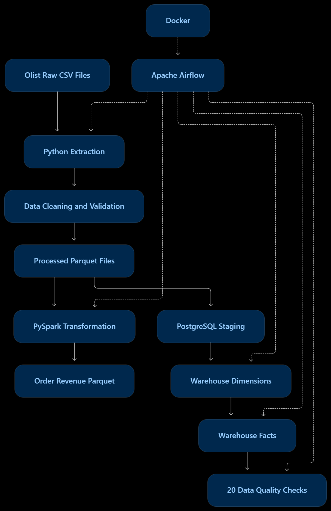

flowchart TD
    A[Olist Raw CSV Files] --> B[Python Extraction]
    B --> C[Data Cleaning and Validation]
    C --> D[Processed Parquet Files]

    D --> E[PostgreSQL Staging]
    E --> F[Warehouse Dimensions]
    F --> G[Warehouse Facts]
    G --> H[20 Data Quality Checks]

    D --> I[PySpark Transformation]
    I --> J[Order Revenue Parquet]

    K[Apache Airflow] -.-> B
    K -.-> F
    K -.-> G
    K -.-> H
    K -.-> I

    L[Docker] -.-> K
